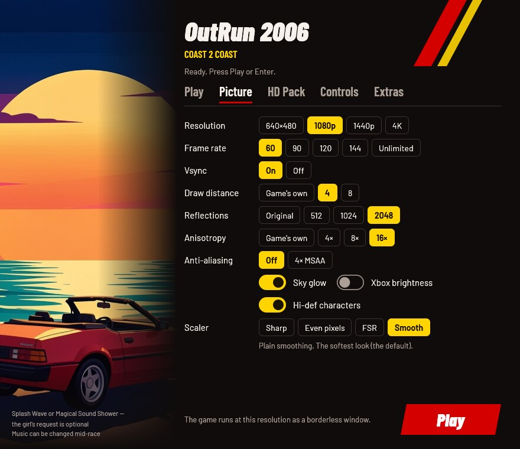
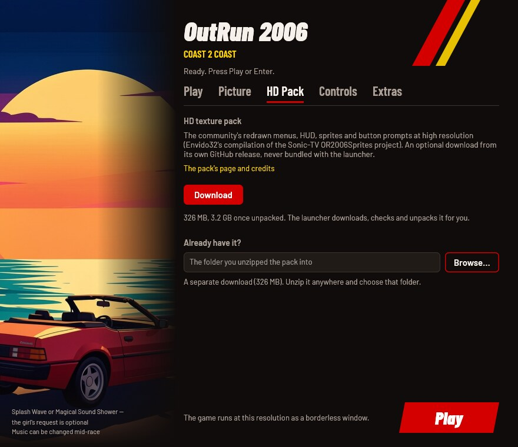
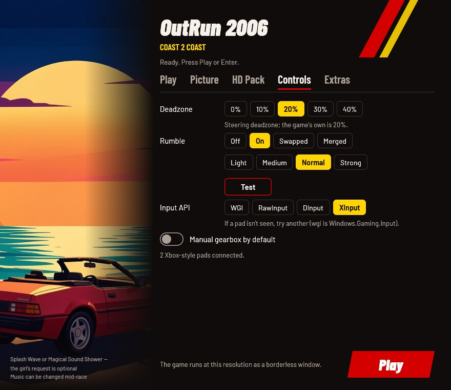
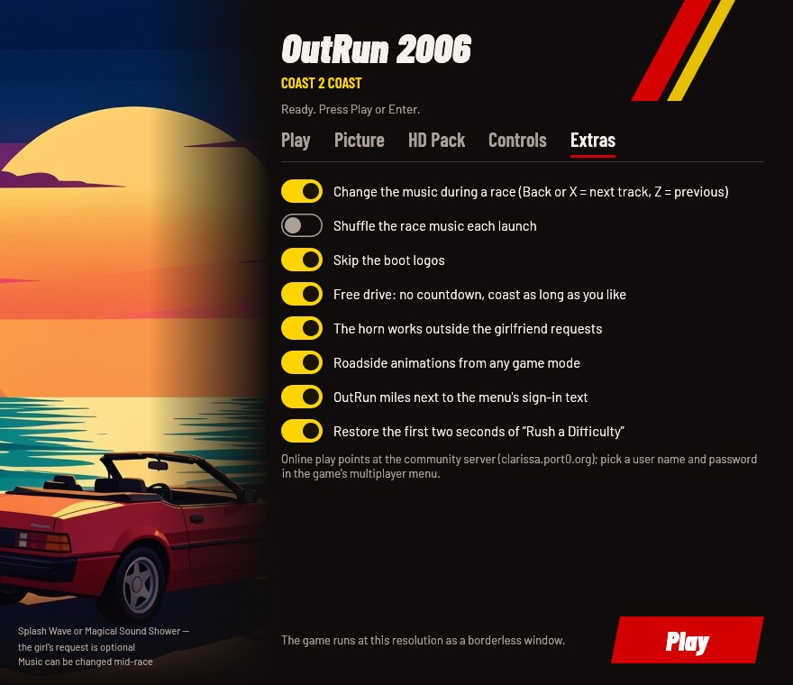

# OutRun 2006: Coast 2 Coast Launcher

Play **your own copy** of the 2006 PC game OutRun 2006: Coast 2 Coast on
Windows 10/11, the Steam Deck and Linux (Proton, your own Wine, or the
AppImage, which brings its own Wine). Point the launcher at your installed
game, pick a look and press **Play**. Everything the game needs is bundled
and set up for you: no mods, patchers, winetricks, DLL overrides,
compatibility modes or registry edits by hand. Your game folder is only
read, never changed; the launcher plays from its own private copy.

This project contains no game files: you need your own copy of the game.

> **Status.** Played end to end on Linux (Wine 11, DXVK, gamescope, an
> Xbox-style pad). Native Windows 10/11, the Steam Deck and Proton without
> `or-play` haven't been play-tested yet. Reports are very welcome at
> <https://github.com/akitaonrails/rea-outrun-2006/issues>.

[](https://new-uploads-akitaonrails.s3.us-east-2.amazonaws.com/2026/11/02/outrun-2006/showcase-h264.mp4)

*The settings window, then the game in 4K with the HD texture pack, played
on Linux. Click to watch (2:43, with sound).*

## Problems this launcher solves

| Problem | What the launcher does |
| --- | --- |
| The 2006 EXE is wrapped in disc DRM that fails on modern Windows and breaks mod loaders. | Uses the DRM-free replacement EXE from [OutRun2006Tweaks](https://github.com/emoose/OutRun2006Tweaks), the community mod that fixes the PC release, and installs the mod itself. |
| Tweaks' tagged releases are years old; current builds only exist as download links that expire after 90 days. | Ships a pinned, play-tested Tweaks build kept in this project's releases. |
| The mod needs a recent 32-bit Visual C++ runtime that most PCs don't have. | Puts the three runtime files next to the game. No installer runs. |
| On Linux: DXVK, DLL overrides, winetricks, and repacks that ship a SpecialK `d3d9.dll` which takes over Direct3D. | Sets up DXVK and the DLL overrides itself and keeps stray `d3d9` files out of its copy. A fresh Wine prefix is enough. |
| Settings live in two INI files with dozens of keys, and the in-game overlay can quietly override them. | One settings window (and one commented `launcher.cfg`). Both INI files are written from it on every start; overlay changes to the keys it manages are reset. |
| Modern pads: shared trigger axes and phantom inputs; under Wine, a d-pad that doesn't move the menus. | Turns on Tweaks' new input system (full trigger range, rumble, impulse triggers) and picks the input method that works on your system. |
| Wine picking a portrait monitor or switching your desktop's video mode. | On Linux, runs the game inside [gamescope](https://github.com/ValveSoftware/gamescope) at the size you chose, scaled to your screen. |
| The PC release's "Rush a Difficulty" is missing its first two seconds. | Applies Tweaks' official patch to the launcher's copy of your song. No music is distributed. |
| The community HD texture pack is a 3.2 GB manual download with no licence. | Downloads it when you ask, checks it, unpacks it and switches it on; the game reads it where it is. |
| Patching the game folder risks the copy you own. | Your folder is only read; the launcher works on its own private copy. |

## Screenshots

<!-- These screenshots predate the window's current layout (a note under
every row, the grouped Picture tab, the caption plate): retake them from
a real window (docs/RUNTIME_NOTES.md). -->

| Play | Picture | HD Pack |
| --- | --- | --- |
|  |  |  |

| Controls | Extras |
| --- | --- |
|  |  |

## What you need

**OutRun 2006: Coast 2 Coast for Windows PC**, installed: the folder with
`OR2006C2C.exe`. The launcher recognises the original 2006 `OR2006C2C.exe`
and a folder already patched with OutRun2006Tweaks' replacement EXE.

If your `OR2006C2C.exe` is another version, the launcher says so, shows
its SHA-256 and doesn't start it. Report that code (never the EXE itself)
with the
[unknown edition form](https://github.com/akitaonrails/rea-outrun-2006/issues/new?template=unknown-edition.yml).

## Download and install

Download from the [latest release](https://github.com/akitaonrails/rea-outrun-2006/releases/latest):
`OutRunLauncher-<version>.zip` for Windows, Steam and your own Wine, or
`OutRunLauncher-<version>-x86_64.AppImage` for Linux.

### Windows

1. Unpack the zip anywhere.
2. Keep its folders (`tweaks`, `vc`, `linux`, `soundtrack`) next to
   `OutRunLauncher.exe`.
3. Run `OutRunLauncher.exe`.

### Steam Deck

In Desktop Mode, either run the AppImage, or unpack the zip and add
`OutRunLauncher.exe` to Steam (*Add a Non-Steam Game*), then force a Proton
version in its Properties → Compatibility. The window recommends the
**Steam Deck** look, and in Game Mode the game runs in Steam's own
gamescope. Game Mode hasn't been tested yet.

### Linux: AppImage

1. `chmod +x OutRunLauncher-<version>-x86_64.AppImage` and run it.
2. It brings its own Wine and keeps its Wine prefix in
   `~/.local/share/or-launcher/prefix`.

Install [gamescope](https://github.com/ValveSoftware/gamescope) for the
best result; without it the game runs in a normal window. Your Linux files
are drive `Z:` in the window.

### Linux: Steam (Proton)

Add `OutRunLauncher.exe` from the unpacked zip as a non-Steam game and
force a Proton version in its compatibility settings. The launcher notices
Proton and sets up DXVK and the DLL overrides itself.

### Linux: your own Wine

Run `linux/or-play` from the unpacked zip: the settings window, then the
game in gamescope. It needs `wine` (and ideally `gamescope`).

```sh
or-play          # the settings window, then the game
or-play --play   # the game with the saved settings, no window
or-play stop     # end the game
or-play status   # running or idle
```

[linux/README.md](linux/README.md) has its options (another prefix, a
wrapper such as a distrobox).

## First run

1. Press **Browse…** and choose the folder with your `OR2006C2C.exe`.
   Under Wine your Linux files are drive `Z:`, e.g.
   `Z:\home\you\Games\OutRun 2006`.
2. Pick a look. **Coast to Coast** is recommended (**Steam Deck** on a
   Deck-sized screen).
3. Press **Play** (or Enter, or Start on a pad).

The first start copies the game into the launcher's own folder (about
1 GB, once); later starts only copy what changed. The HD texture pack is
optional: nothing is downloaded unless you press **Download** in the HD
Pack tab.

## The settings window

**Play**: the folder with your game, the four looks, and your saves
folder.

| Look | Resolution | Frame rate | What else | When to pick it |
| --- | --- | --- | --- | --- |
| **Original 2006** | 640×480 | 60 | the game's own picture | to play the game as it shipped |
| **Coast to Coast** (recommended) | your screen's | 60 | longer draw distance, sharp reflections, 16× anisotropic filtering, the console versions' sky glow, the hi-def characters, the CD switcher, no boot logos, free drive | the first run picks it on most screens |
| **Steam Deck** | 1280×800 | 60 | lighter reflections, easy on the battery | picked on a Deck-sized screen |
| **Custom** | — | — | any change in the other tabs | when you change something yourself |

**Picture**: the screen (resolution as a borderless window, exclusive
fullscreen, frame rate, vsync), the detail (draw distance, car
reflections, anisotropic filtering, anti-aliasing) and effects (sky glow,
Xbox brightness, hi-def characters). On Linux, how gamescope enlarges the
picture: Smooth, Sharp, Even pixels or FSR.

**HD Pack**: the community HD texture pack redraws the menus, HUD, sprites
and button prompts (Envido32's compilation of the Sonic-TV OR2006Sprites
project). **Download** fetches it from the pack's own GitHub release
(326 MB) with progress, speed and time left; **Cancel** stops it, and
**Download** later carries on from where it stopped. The launcher checks
the download and the free space, unpacks it (3.2 GB) and switches it on;
**Remove** deletes it. Or choose a copy you already unzipped. Details:
[docs/HD_TEXTURES.md](docs/HD_TEXTURES.md).

**Controls**: the steering deadzone, rumble (off, on, motors swapped, or
merged) with its strength and a **Test rumble** button for Xbox-style
pads, impulse triggers for Xbox One/Series pads (Windows only), the input
API (only for a pad that isn't seen), and the manual gearbox.

**Extras**: the CD switcher (change the music during a race: Back or X
for the next track, Z for the previous one) with optional shuffle,
skipping the boot logos, free drive (no countdown), the horn any time,
roadside animations from any game mode, OutRun miles on the menu, and the
"Rush a Difficulty" fix. Online play goes to the community server
(clarissa.port0.org); pick a user name and password in the game's
multiplayer menu.

The window works with a pad or the keyboard alone: the d-pad or arrows
move, A or Enter press, LB/RB or Ctrl+Tab change tabs, Start plays. Every
row says in one line what it changes, and a control you can't use right
now (impulse triggers under Wine, shuffle without the CD switcher) is
greyed out with the reason under it.

## Options

Every option has the same name in the window, in `launcher.cfg` (with
underscores) and on the command line (with hyphens). **Where things live**
says where `launcher.cfg` is; the first run writes it with every option
commented. Settings are saved when you press **Play**.

| `launcher.cfg` / flag | In the window | Values | Unset | What it changes |
| --- | --- | --- | --- | --- |
| `game` / `--game` | Play: Game folder | a folder | the launcher's own folder, if the game is there | The folder with your `OR2006C2C.exe`. Only read, never changed. |
| `look` / `--look` | Play: the look cards | `original`, `coast_to_coast`, `steam_deck` | Coast to Coast | Every picture, control and extra setting at once; settings given on their own win over it. |
| `saves` / `--saves` | Play: Saves | a folder | `Saved Games\OutRun 2006` | Where your saves are kept: copied into the game before it starts and back when it ends. |
| `runtime` / `--runtime` | — (file and flag only) | a folder | `%LOCALAPPDATA%\OutRunLauncher\OutRun2006` | Where the launcher keeps its private copy of the game. |
| `resolution` / `--resolution` | Picture: Resolution | `WIDTHxHEIGHT`, `original` or `off` | the game's 640×480 | The size the game draws at, as a borderless window. |
| `fullscreen` / `--fullscreen` | Picture: Exclusive fullscreen | `on`, `off` | `off` | Takes over the screen instead of a borderless window. Holds the frame rate at 60. |
| `fps_limit` / `--fps-limit` | Picture: Frame rate | 10 to 240, or `unlimited` (0) | 60 | Frames per second. Above 60 the picture is interpolated between the game's 60 ticks a second (experimental). |
| `vsync` / `--vsync` | Picture: Vsync | `on`, `off` | `on` | Waits for the screen's refresh: no tearing, a little more delay. |
| `draw_distance` / `--draw-distance` | Picture: Draw distance | 0 to 8 | 4 | How much further down the road the scenery is drawn (0 is the game's own). |
| `reflections` / `--reflections` | Picture: Reflections | `original` (128), `512`, `1024`, `2048` | 2048 | How sharp the reflections on the car are. |
| `anisotropy` / `--anisotropy` | Picture: Anisotropy | 0 to 16 | 16 | Keeps the road's texture sharp into the distance (0 is the game's own). |
| `antialiasing` / `--antialiasing` | Picture: Anti-aliasing | `0`, `2` (the game's 4× MSAA) | 0 | Smooths jagged edges; on NVIDIA under Windows, trackside cloth and barriers too. |
| `sky_glow` / `--sky-glow` | Picture: Sky glow | `on`, `off` | `on` | The console versions' glowing sky. |
| `xbox_brightness` / `--xbox-brightness` | Picture: Xbox brightness | `on`, `off` | `off` | The brighter picture of the Xbox release. |
| `hd_characters` / `--hd-characters` | Picture: Hi-def characters | `on`, `off` | `on` | The detailed driver and passenger models the PC release shipped but never used. |
| `scaler` / `--scaler` | Picture: Scaler (Linux only) | `nearest` (Sharp), `pixel` (Even pixels), `fsr`, `linear` (Smooth) | `linear` | How gamescope enlarges the picture to your screen. |
| `hd_textures` / `--hd-textures` | HD Pack: Use the HD texture pack | `on`, `off` | `off` | The community's sharper menus, HUD, sprites and button prompts. |
| `hd_textures_folder` / `--hd-textures-folder` | HD Pack: Pack folder | a folder | the downloaded pack, or `textures-pack` next to the launcher | Where the HD pack was unzipped. |
| `deadzone` / `--deadzone` | Controls: Deadzone | 0 to 50 | 20 | How far the stick moves before the car steers, in percent. |
| `vibration` / `--vibration` | Controls: Rumble | `off`, `on`, `swapped`, `merged` | `on` | The pad shakes on shifts, drifts and crashes; swapped trades the motors, merged drives both together. |
| `vibration_strength` / `--vibration-strength` | Controls: Strength | 0 to 10 | 7 | How strongly the pad shakes. |
| `impulse_triggers` / `--impulse-triggers` | Controls: Impulse triggers | `off`, `on`, `swapped`, `merged` | `swapped` | Rumble in the triggers of Xbox One and Series pads, on Windows. |
| `input_backend` / `--input-backend` | Controls: Input API | `auto`, `wgi`, `raw`, `dinput`, `xinput` | `auto`: WGI on Windows, XInput under Wine and Proton | How the game reads pads; change it only if a pad isn't seen. |
| `manual_gearbox` / `--manual-gearbox` | Controls: Manual gearbox | `on`, `off` | `off` | Races start with the manual gearbox selected. |
| `cd_switcher` / `--cd-switcher` | Extras: CD switcher | `on`, `off` | `on` | Change the music during a race. |
| `music_shuffle` / `--music-shuffle` | Extras: Shuffle the music | `on`, `off` | `off` | The race music comes in a new order each time the game starts. |
| `skip_logos` / `--skip-logos` | Extras: Skip the boot logos | `on`, `off` | `on` | Straight to the title screen. |
| `free_drive` / `--free-drive` | Extras: Free drive | `on`, `off` | `on` | No countdown timer: drive as long as you like. |
| `horn` / `--horn` | Extras: Horn any time | `on`, `off` | `on` | The horn works all the time, not only when your passenger asks for it. |
| `random_anims` / `--random-anims` | Extras: Roadside animations | `on`, `off` | `on` | Roadside animations from every game mode can appear on any stage. |
| `show_miles` / `--show-miles` | Extras: OutRun miles | `on`, `off` | `on` | Shows your OutRun miles next to the menu's sign-in text. |
| `soundtrack_fix` / `--soundtrack-fix` | Extras: Soundtrack fix | `on`, `off` | `on` | Restores the first two seconds of "Rush a Difficulty". |

An unset option gets the launcher's default, the Coast to Coast value
shown in its `#key =` line (the resolution is the exception: unset, it is
the game's own 640×480). On every start the launcher sets the keys it
manages in the game's `outrun2006.ini` and in `OutRun2006Tweaks.ini`, and
keeps every other line of both (the game's language, comments, keys it
doesn't manage).

Any option on the command line skips the window and plays; options
override `launcher.cfg` for that run, and only `--game` is remembered. The
launcher's own switches:

| Switch | What it does |
| --- | --- |
| `--no-window` | play with the saved settings (and any options given) |
| `--settings` | only the settings window; exit code 0 when Play was pressed, 3 when it was closed, 4 when no window could be shown (`--linux` adds the Linux scaler, for `or-play`) |
| `--check` | checks the game folder and the launcher's files without playing; the report goes to `launcher.log`; exit code 0 ready, 1 not |
| `--download-hd-pack` | downloads the HD texture pack and switches it on |
| `--help` | every option and its values |

A bad option or value exits with code 2 and says what it takes.

## Where things live

| What | Windows | Linux (AppImage, `or-play`) |
| --- | --- | --- |
| Settings (`launcher.cfg`) and log (`launcher.log`) | `%LOCALAPPDATA%\OutRunLauncher\` | in the prefix, `drive_c/users/<you>/AppData/Local/OutRunLauncher/` |
| The launcher's copy of the game | `%LOCALAPPDATA%\OutRunLauncher\OutRun2006` (about 1 GB) | in the prefix, `…/AppData/Local/OutRunLauncher/OutRun2006` |
| Your saves | `%USERPROFILE%\Saved Games\OutRun 2006` (or the folder you chose) | in the prefix, `drive_c/users/<you>/Saved Games/OutRun 2006` |
| The downloaded HD pack | `%LOCALAPPDATA%\OutRunLauncher\hd-pack` (3.2 GB) | in the prefix, `…/AppData/Local/OutRunLauncher/hd-pack` |
| Wine prefix | — | `~/.local/share/or-launcher/prefix` |
| `or-play`'s log (`play.log`) and lock | — | `~/.config/or-launcher` |

A `launcher.cfg` next to `OutRunLauncher.exe` is used instead when it
exists (a portable install). Under Proton everything is in Steam's
`compatdata/<appid>/pfx` for the non-Steam game. The game writes its saves
(`License.dat`, your records) into the launcher's copy; the launcher copies
them into your saves folder when the game ends and back in before the next
start, so your saves folder always has them.

## Troubleshooting

- **"This OR2006C2C.exe is a version the launcher doesn't know."** Your
  EXE isn't one of the known builds. Report the SHA-256 it shows and where
  your copy comes from with the
  [unknown edition form](https://github.com/akitaonrails/rea-outrun-2006/issues/new?template=unknown-edition.yml).
- **"OutRun 2006 is already running."** The launcher you started first is
  still waiting for the game. Quit the game, then start the launcher
  again.
- **The pad isn't seen, or the d-pad doesn't move the menus.** Try another
  Input API in the Controls tab (XInput under Wine and Proton, then
  DirectInput). On 8BitDo pads use the X-input mode switch.
- **The HD pack is on but the game looks the same.** Check the HD Pack
  tab: the note under the folder says whether it holds the pack.
  `launcher.log` says which folder the game was given.
- **Your own `WINEDLLOVERRIDES` don't apply.** Rules for the DLLs the
  launcher sets (`dinput8`, `d3d9`, `mscoree`, `mshtml`) are replaced by
  the launcher's; your other rules are kept.
- **Start over.** Delete the `OutRun2006` folder next to `launcher.cfg`;
  the next start copies the game again. Your saves are kept separately.
- **Anything else:** run `OutRunLauncher --check`, then report it with the
  [bug report form](https://github.com/akitaonrails/rea-outrun-2006/issues/new?template=bug-report.yml),
  attaching `launcher.log` (remove personal paths). On Linux add
  `~/.config/or-launcher/play.log`. Crash reports land in the copy's
  `CrashDumps` folder. Never attach game files.

## Known limitations

- Not yet checked in the real game: native Windows 10/11, the Steam Deck in
  Game Mode, Proton without `or-play`, frame rates above 60 (marked
  experimental by OutRun2006Tweaks), impulse triggers, and input APIs
  other than XInput and WGI. [docs/RUNTIME_NOTES.md](docs/RUNTIME_NOTES.md)
  keeps the list.

## Uninstall

1. **Back up your saves**: `%USERPROFILE%\Saved Games\OutRun 2006` (or the
   `saves` folder you chose). On Linux they are inside the Wine prefix
   (`drive_c/users/<you>/Saved Games/OutRun 2006`), so the prefix steps
   below delete them: copy them out first.
2. Delete the folder you unpacked (or the AppImage).
3. Windows: delete `%LOCALAPPDATA%\OutRunLauncher`: settings, log, the
   private copy of the game (about 1 GB) and the downloaded HD pack
   (3.2 GB).
4. Linux: delete the prefix `~/.local/share/or-launcher/prefix` and
   `~/.config/or-launcher`, after copying the saves out. Proton: removing
   the shortcut in Steam offers to delete its prefix, saves included.

Your game folder was never changed, so there is nothing to undo there.

## For developers

Rust (edition 2024), MinGW-w64 for i686 with lld, Wine for the
Windows-target tests, and `cargo-deny`; the `gaming` distrobox has them
all. The Windows target links with lld (`.cargo/config.toml`): GNU ld 2.47
drops one of the two `kernel32.dll` import groups and the launcher would
crash at start.

```sh
cargo fmt --all --check
cargo test --workspace --locked                 # host tests, the window headless
cargo clippy --release --target i686-pc-windows-gnu --workspace --all-targets -- -D warnings
cargo deny check
for t in linux/tests/*.sh packaging/tests/*.sh; do sh "$t"; done
cargo build --release --locked --target i686-pc-windows-gnu
sdk/packaging/check-imports.sh target/i686-pc-windows-gnu/release/OutRunLauncher.exe
sdk/scripts/wine-test --locked --workspace      # Windows-target tests under Wine, headless
sh ../rea-launcher-sdk/scripts/sdk-sync --check .   # sdk/ matches the pinned SDK tag
```

- `packaging/package.sh dist/OutRunLauncher` assembles the zip's folder,
  and the AppImage adds a portable Wine to it:

  ```sh
  sdk/packaging/appimage-wine.sh --app or --exe OutRunLauncher.exe \
    --icon packaging/appimage/outrun-launcher.png \
    --desktop packaging/appimage/outrun-launcher.desktop \
    --payload linux --optional-payload tweaks --optional-payload vc \
    --optional-payload soundtrack dist/OutRunLauncher dist
  ```

  Its `AppRun` puts the bundled Wine first on the `PATH` and runs
  `or-play`. Third-party components are fetched at package time from the
  URLs and SHA-256 digests in `packaging/*.txt` (Wine and the AppImage
  tools in `sdk/packaging/appimage/tools.pins`).
- CI (`.github/workflows/build.yml`, on the SDK's reusable workflows)
  tests, lints, audits, builds and packages every push and pull request,
  runs the Windows-target tests under Wine and checks the zip against
  `packaging/package.allow`; a `v*` tag publishes the zip and the AppImage
  as a release. `tweaks-update` looks for newer OutRun2006Tweaks builds
  every week ([docs/TWEAKS.md](docs/TWEAKS.md)); `sdk-update` opens a pull
  request for a new SDK tag; `mirror` keeps copies of DXVK and the VC++
  redistributable in the `thirdparty` release.
- The golden snapshots in `crates/or-launcher/tests/snapshots/` hold
  `--help`, the `launcher.cfg` template and what each look writes. Review
  every diff; regenerate with `UPDATE_SNAPSHOTS=1 cargo test --test
  snapshots` only for an intended change.
- To move to a new SDK version, run `sdk/scripts/sdk-bump vX.Y.Z` (Cargo
  tags, `sdk/`, workflow pins; it prints the Migration notes) and follow
  `sdk/docs/playbooks/sdk-change.md`.
- `sdk/scripts/clean` lists the build output it would remove to free disk
  space; `sdk/scripts/clean --yes` removes it.
- More: [AGENTS.md](AGENTS.md) (rules for contributors and agents),
  [docs/RESEARCH.md](docs/RESEARCH.md),
  [docs/RUNTIME_NOTES.md](docs/RUNTIME_NOTES.md),
  [docs/CONTRIBUTIONS.md](docs/CONTRIBUTIONS.md),
  [docs/TWEAKS.md](docs/TWEAKS.md),
  [docs/HD_TEXTURES.md](docs/HD_TEXTURES.md).

## How it works

1. The launcher checks your `OR2006C2C.exe` by SHA-256 and copies the game
   into its own folder (only changed files after the first time; never the
   other way).
2. It installs the bundled OutRun2006Tweaks files, the VC++ runtime and,
   under Wine, DXVK into that copy, and applies the soundtrack patch.
3. It writes `outrun2006.ini` and `OutRun2006Tweaks.ini` from your
   settings and points Tweaks at the HD pack where it was unpacked.
4. It copies your saves in, starts the game, waits for it, and copies the
   saves back.

## Built on rea-launcher-sdk

The runtime copy, saves, the settings file and option table, INI editing,
downloads, the Win32 helpers, the settings window's widgets, `rea-play.sh`,
the AppImage builder and CI come from the shared
[rea-launcher-sdk](https://github.com/akitaonrails/rea-launcher-sdk): the
Rust crates as git dependencies pinned by tag in `Cargo.toml`, the shell
and packaging scripts and the standards vendored in `sdk/` (the tag is in
`sdk/VERSION`). This repository holds what is OutRun's: the edition table,
the two INI generators, the Tweaks, DXVK, HD pack and soundtrack steps,
the window's tabs, palette and art, and `or-play`'s settings.

## Contributing

- **About OutRun 2006** (its editions, the Tweaks wiring, the HD pack, the
  window's tabs, `or-play`'s game settings, this README): issues and pull
  requests here.
- **Shared code** (the runtime folder, settings-window widgets, the option
  table, downloads, `rea-play.sh`, packaging, CI workflows, anything under
  `sdk/`): issues and pull requests at
  [rea-launcher-sdk](https://github.com/akitaonrails/rea-launcher-sdk/issues).
- **How to tell:** code under `sdk/` or from a `rea_launcher*` crate is the
  SDK's. If the same problem would happen with another rea launcher, it's
  the SDK's. Not sure? Open it here and it will be moved.
- Never patch `sdk/` or copy SDK code here: fix the SDK and bump the tag.
- Never attach game files (executables, saves, data) to an issue.
- Test reports are welcome: the
  [bug report form](https://github.com/akitaonrails/rea-outrun-2006/issues/new?template=bug-report.yml)
  works for "it played fine on …" too.

## Credits

- [OutRun2006Tweaks](https://github.com/emoose/OutRun2006Tweaks) by emoose:
  every fix to the game itself, the DRM-free EXE and the Soundtrack Fix.
- The HD texture pack: Envido32's compilation of the
  [Sonic-TV OR2006Sprites](https://github.com/Sonic-TV/OR2006Sprites)
  project and its contributors.
- [DXVK](https://github.com/doitsujin/dxvk) by Philip Rebohle and
  contributors: Direct3D 9 on Linux.
- [xdelta](https://github.com/jmacd/xdelta-gpl) by Joshua MacDonald: applies
  the soundtrack patch.
- The Microsoft Visual C++ runtime, redistributed as Microsoft allows.
- [Wine](https://www.winehq.org), in
  [Kron4ek's portable builds](https://github.com/Kron4ek/Wine-Builds), and
  the [AppImage](https://github.com/AppImage/type2-runtime) tools: the
  AppImage.
- [gamescope](https://github.com/ValveSoftware/gamescope) by Valve: the
  Linux helper runs the game inside it.
- The window's sunset-coast artwork and the AppImage icon, made for this
  project; the [Barlow](https://github.com/jpt/barlow) fonts by Jeremy
  Tribby (SIL OFL 1.1).
- [PCGamingWiki's OutRun 2006 page](https://www.pcgamingwiki.com/wiki/OutRun_2006:_Coast_2_Coast),
  where the community fixes were found.
- [rea-launcher-sdk](https://github.com/akitaonrails/rea-launcher-sdk).

Full list with licences: [THIRD_PARTY.md](THIRD_PARTY.md).

## Legal

OutRun is a trademark of SEGA, which holds the game's copyright. This project is not affiliated with or endorsed by
SEGA. It contains no game files and only runs a copy you own. Its code is
licensed under [MIT](LICENSE-MIT) OR [Apache-2.0](LICENSE-APACHE); bundled
components keep their own licences ([THIRD_PARTY.md](THIRD_PARTY.md)).
xdelta3 (GPL-2.0) is the unmodified upstream build; its source is at
<https://github.com/jmacd/xdelta-gpl>.
