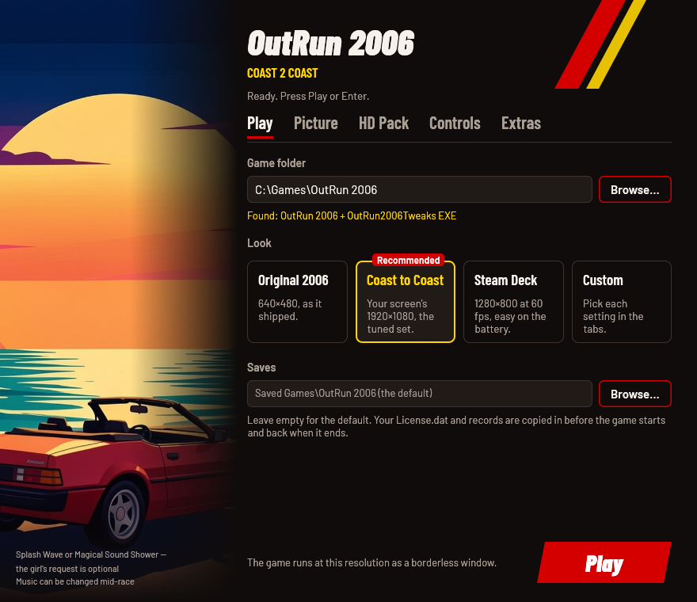
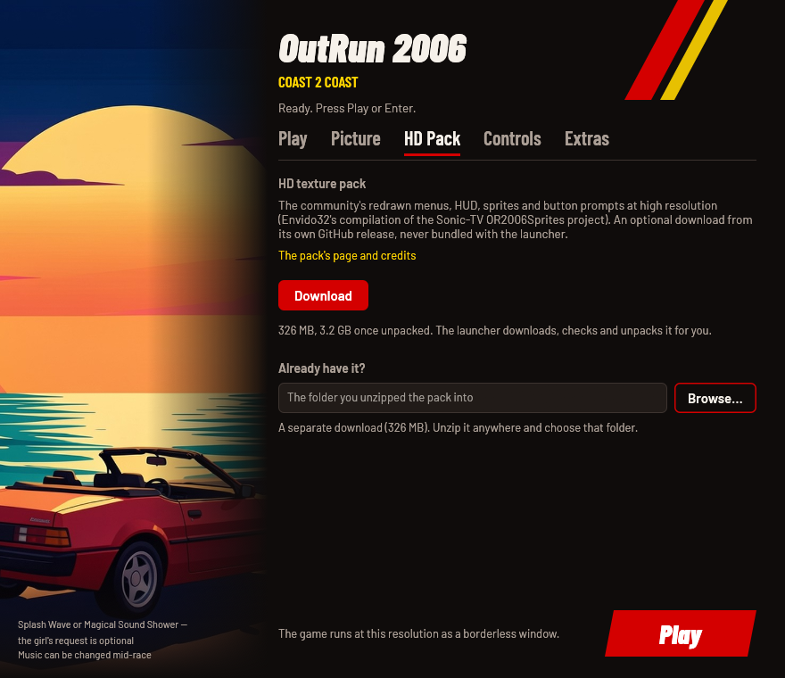
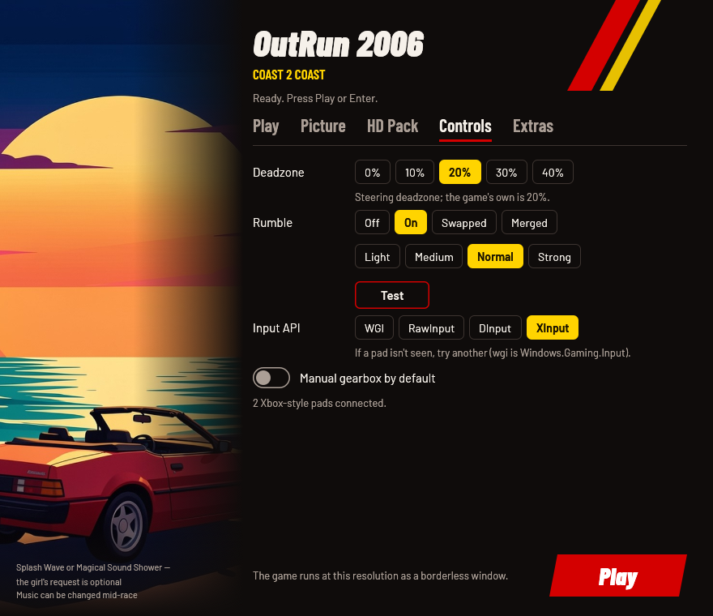
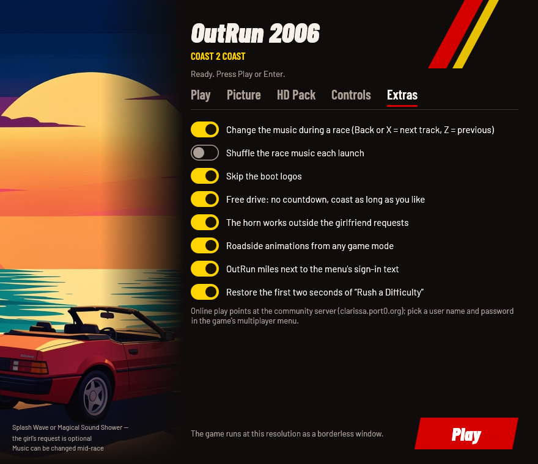

# OutRun 2006: Coast 2 Coast — play it today

Play your own copy of the 2006 PC game **OutRun 2006: Coast 2 Coast** on a
modern computer: Windows 10/11, or Linux through Steam (Proton), your own
Wine, or the AppImage, which brings its own Wine.

Point the launcher at your installed game, pick a look and press Play.
You don't install mods, patchers, winetricks, DLL overrides, compatibility
modes or registry edits: everything the game needs is bundled and set up
for you. Your game folder is never changed; the launcher plays from its
own private copy.



This project contains **no game files**. You need your own copy of the
game. OutRun is a trademark of SEGA; this project is not affiliated with or
endorsed by SEGA.

> **Status (v0.1.0).** Played end to end on Linux (Wine 11, DXVK,
> gamescope, an Xbox-style pad). Native Windows 10/11 hasn't been
> play-tested yet; reports are very welcome at
> <https://github.com/akitaonrails/rea-outrun-2006/issues>.

## The problems it solves

Getting the 2006 PC release running well today takes a pile of fixes, each
with its own catch:

| Problem | What the launcher does |
| --- | --- |
| The 2006 EXE is wrapped in disc DRM that fails on modern Windows and breaks mod loaders. | Uses the DRM-free replacement EXE from [OutRun2006Tweaks](https://github.com/emoose/OutRun2006Tweaks), the community mod that fixes the PC release, and installs the mod itself. |
| Tweaks' tagged releases are years old; current builds only exist as GitHub Actions artifacts that expire after 90 days. | Ships a pinned, play-tested Tweaks build kept as a release of this repository, with a reviewed update route ([docs/TWEAKS.md](docs/TWEAKS.md)). |
| The mod needs a recent x86 Visual C++ runtime that most PCs don't have. | Deploys the three runtime DLLs next to the game. No installer runs. |
| On Linux: DXVK, native DLL overrides, winetricks, and repacks that ship a SpecialK `d3d9.dll` which hijacks Direct3D. | Wires DXVK and the DLL overrides itself and keeps stray `d3d9` files out of its copy. A fresh prefix is enough. |
| Settings live in two INI files with dozens of keys, and the in-game overlay can silently override them. | One settings window (and one commented `launcher.cfg`). Both INI files are written from it on every start; overlay changes to the keys it manages are reset. |
| Modern pads: shared trigger axes and phantom inputs through the game's DirectInput; under Wine, a d-pad that doesn't move the menus. | Turns on Tweaks' SDL input system (full trigger range, rumble, impulse triggers) and picks the input API that works on your platform. |
| Wine picking a portrait monitor or switching your desktop's video mode. | On Linux, runs the game inside [gamescope](https://github.com/ValveSoftware/gamescope) at the size you chose, scaled to your screen. |
| The PC release's "Rush a Difficulty" is missing its first two seconds. | Applies Tweaks' official patch to the launcher's copy of your song. No music is distributed. |
| The community HD texture pack is a 3.2 GB manual download with no licence. | Downloads it on request, checks it, unpacks it and switches it on; the game reads it in place. |

## What's in the window

**Play**: the folder with your game, your saves folder, and four looks.

- **Coast to Coast** (recommended): your screen's resolution, 60 fps,
  longer draw distance, sharp reflections, 16× anisotropic filtering, the
  console versions' sky glow, the hi-def characters, the CD switcher, no
  boot logos, free drive.
- **Original 2006**: 640×480 and the game's own picture.
- **Steam Deck**: 1280×800 at 60 fps with lighter reflections, easy on the
  battery. Recommended automatically on a Deck-sized screen.
- **Custom**: any change in the other tabs.

**Picture**


- Resolution: 640×480, your screen's size, 1080p, 1440p or 4K, as a
  borderless window (exclusive fullscreen is a `launcher.cfg` setting).
- Frame-rate cap: 60, 90, 120, 144 or unlimited. Above 60 the picture is
  interpolated between the game's 60 logic ticks (Tweaks marks this
  experimental). Vsync on or off.
- Draw distance: the game's own, 4 or 8 sections further (further out,
  scenery starts to pop in).
- Car reflections at 128 (original), 512, 1024 or 2048 pixels; anisotropic
  filtering 4× to 16×; the game's 4× multisampled anti-aliasing (on NVIDIA
  under Windows, trackside cloth and barriers are supersampled too).
- Sky glow, Xbox brightness and the hi-def driver and passenger models the
  PC release shipped unused.
- Linux only: how gamescope enlarges the picture (smooth, sharp, even
  pixels or FSR).

**HD Pack**



The community HD texture pack redraws the menus, HUD, sprites and button
prompts (Envido32's compilation of the Sonic-TV OR2006Sprites project).
**Download** fetches it from the pack's own GitHub release (326 MB) with
progress, speed and time left; **Cancel** and **Resume download** carry on
later. The launcher checks its SHA-256 and free space, unpacks it (3.2 GB),
and switches it on; **Remove** deletes it. Or choose a copy you already
unzipped. Details: [docs/HD_TEXTURES.md](docs/HD_TEXTURES.md).

**Controls**



- Steering deadzone (0 to 40 %, the game's own is 20 %).
- Rumble off, on, with the motors swapped, or merged; four strengths; a
  **Test** button for Xbox-style pads.
- Impulse triggers for Xbox One/Series pads (Windows only).
- Input API: Windows.Gaming.Input, RawInput, DirectInput or XInput. The
  default is Windows.Gaming.Input on Windows and XInput under Wine and
  Proton.
- Start races with the manual gearbox.

The window itself works with a pad: the d-pad moves, A presses, LB/RB
change tabs, Start plays.

**Extras**



- CD switcher: change the music during a race (Back or X = next track,
  Z = previous), with optional shuffle.
- Skip the boot logos; free drive (no countdown, coast as long as you
  like); the horn outside the girlfriend's requests; roadside animations
  from any game mode; OutRun miles on the menu.
- Restore the first two seconds of "Rush a Difficulty".
- Online play goes to the community server (clarissa.port0.org); pick a
  user name and password in the game's multiplayer menu.

## 1. The game you need

**OutRun 2006: Coast 2 Coast for Windows PC**, installed. The launcher
recognises the original 2006 `OR2006C2C.exe`, a folder already patched with
OutRun2006Tweaks' replacement EXE, and the replacement EXE it ships itself.
If yours is another version, it says so and shows the file's SHA-256;
please report it with where your copy comes from.

## 2. Install and run

### Windows 10/11

1. Download `OutRunLauncher-v0.1.0.zip` from the
   [releases](https://github.com/akitaonrails/rea-outrun-2006/releases) and
   unpack it anywhere. Keep its folders (`tweaks`, `vc`, `linux`,
   `soundtrack`) next to `OutRunLauncher.exe`.
2. Run `OutRunLauncher.exe`, choose the folder with your `OR2006C2C.exe`
   (**Browse…**), pick a look and press **Play**.

The first start copies the game into the launcher's own folder (about
1 GB, once); later starts only copy what changed.

### Linux: the AppImage (no Wine needed)

1. Download `OutRunLauncher-v0.1.0-x86_64.AppImage` from the
   [releases](https://github.com/akitaonrails/rea-outrun-2006/releases).
2. `chmod +x OutRunLauncher-v0.1.0-x86_64.AppImage` and run it.
3. In the window, choose your game folder as Wine sees it, e.g.
   `Z:\home\you\Games\OutRun 2006` (**Browse…** does this for you).

It carries a portable Wine 11 and uses its own prefix in
`~/.local/share/or-launcher/prefix`. Install
[gamescope](https://github.com/ValveSoftware/gamescope) for the best
result; without it the game runs in a normal window.

### Linux: Steam (Proton)

Add `OutRunLauncher.exe` from the unpacked zip as a non-Steam game and
force a Proton version in its compatibility settings. The launcher detects
Proton and wires DXVK and the DLL overrides itself.

### Linux: your own Wine

Run `linux/or-play` from the unpacked zip: the settings window, then the
game in gamescope. `or-play --play` skips the window, `or-play stop` ends
the game. It needs `wine` (and ideally `gamescope`). See
[linux/README.md](linux/README.md) for its options (prefix, a wrapper such
as `distrobox enter gaming --`).

### Steam Deck

Use the AppImage in Desktop Mode or add `OutRunLauncher.exe` to Steam with
Proton. The window recommends the **Steam Deck** look, and Game Mode's
gamescope is used as is.

## 3. Settings

Everything the window shows is saved in one commented text file,
`launcher.cfg`:

- Windows: `%LOCALAPPDATA%\OutRunLauncher\launcher.cfg`
- AppImage and `or-play`:
  `~/.local/share/or-launcher/prefix/drive_c/users/<you>/AppData/Local/OutRunLauncher/launcher.cfg`
- A `launcher.cfg` next to `OutRunLauncher.exe` is used instead when it
  exists (a portable install).

Settings are saved when you press Play. On every start the launcher writes
the game's `outrun2006.ini` whole, and the keys it manages in
`OutRun2006Tweaks.ini`, keeping that file's comments and other keys.

| `launcher.cfg` key | Command line | Values (default first or marked) | In the window |
| --- | --- | --- | --- |
| `game` | `--game <folder>` (remembered) | the folder with `OR2006C2C.exe` | Play |
| `saves` | `--saves <folder>` | default `Saved Games\OutRun 2006` | Play |
| `runtime` | `--runtime <folder>` | the launcher's copy of the game; default `%LOCALAPPDATA%\OutRunLauncher\OutRun2006` | — |
| `resolution` | `--resolution WxH` | unset = the game's 640×480 (the window picks your screen's size on first run); `original`, or e.g. `1920x1080` | Picture |
| `fullscreen` | `--fullscreen on\|off` | off (borderless window); exclusive fullscreen holds the frame rate at 60 | — |
| `fps_limit` | `--fps-limit` | 60; 10 to 240, or `unlimited` (0) | Picture |
| `vsync` | `--vsync on\|off` | on | Picture |
| `draw_distance` | `--draw-distance` | 4; 0 (the game's own) to 8 | Picture |
| `reflections` | `--reflections` | 2048; `original` (128), 512, 1024 | Picture |
| `anisotropy` | `--anisotropy` | 16; 0 (the game's own) to 16 | Picture |
| `antialiasing` | `--antialiasing 0\|2` | 0; 2 = the game's 4× MSAA | Picture |
| `sky_glow` | `--sky-glow on\|off` | on | Picture |
| `xbox_brightness` | `--xbox-brightness on\|off` | off | Picture |
| `hd_characters` | `--hd-characters on\|off` | on | Picture |
| `scaler` | — (Linux, `or-play`) | `linear` (smooth), `nearest`, `pixel`, `fsr` | Picture |
| `hd_textures` | `--hd-textures on\|off` | off | HD Pack |
| `hd_textures_folder` | `--hd-textures-folder <folder>` | the unzipped pack; default: the downloaded one, or `textures-pack` next to the launcher | HD Pack |
| `deadzone` | `--deadzone` | 20; 0 to 50 % | Controls |
| `vibration` | `--vibration` | `on`; `off`, `swapped`, `merged` | Controls |
| `vibration_strength` | `--vibration-strength` | 7; 0 to 10 | Controls |
| `impulse_triggers` | `--impulse-triggers` | `swapped`; `off`, `on`, `merged` (Xbox One/Series pads, Windows) | Controls |
| `input_backend` | `--input-backend` | unset or `auto` = by platform; `wgi`, `raw`, `dinput`, `xinput` | Controls |
| `manual_gearbox` | `--manual-gearbox on\|off` | off | Controls |
| `cd_switcher` | `--cd-switcher on\|off` | on | Extras |
| `music_shuffle` | `--music-shuffle on\|off` | off | Extras |
| `skip_logos` | `--skip-logos on\|off` | on | Extras |
| `free_drive` | `--free-drive on\|off` | on | Extras |
| `horn` | `--horn on\|off` | on | Extras |
| `random_anims` | `--random-anims on\|off` | on | Extras |
| `show_miles` | `--show-miles on\|off` | on | Extras |
| `soundtrack_fix` | `--soundtrack-fix on\|off` | on; off restores the original song | Extras |

Command-line values override the file for one run; only `--game` is saved.

### Command-line modes

```text
OutRunLauncher                      the settings window, then the game
OutRunLauncher --no-window [opts]   play with the saved settings (and any options)
OutRunLauncher --settings [--linux] only the window (exit 0: play, 3: closed,
                                    4: no window could be shown)
OutRunLauncher --check              is this game folder supported?
OutRunLauncher --download-hd-pack   download the HD pack and switch it on
OutRunLauncher --help               all options
```

## 4. Troubleshooting

- **The pad isn't seen, or the d-pad doesn't move the menus.** Try another
  Input API in the Controls tab (XInput under Wine and Proton, then
  DirectInput). On 8BitDo pads use the X-input mode switch.
- **"A version the launcher doesn't know".** Your `OR2006C2C.exe` isn't one
  of the known builds; open an issue with the SHA-256 it shows and where
  your copy comes from.
- **The HD pack is on but the game looks the same.** Check the HD Pack
  tab: the note under the folder says whether it holds the pack.
  `launcher.log` says which folder the game was given.
- **Logs:** `launcher.log` next to `launcher.cfg`; the mod's
  `OutRun2006Tweaks.log` in the runtime copy (`OutRun2006` next to it);
  on Linux, `or-play`'s output in `~/.config/or-launcher/play.log`. Crash
  dumps land in the runtime copy's `CrashDumps` folder.
- **Start over.** Delete the `OutRun2006` folder next to `launcher.cfg`;
  the next start copies the game again. Your saves are kept separately.

## How it works

1. The launcher checks your `OR2006C2C.exe` by SHA-256 and copies the game
   into its own folder (only changed files after the first time; never the
   other way).
2. It installs the bundled OutRun2006Tweaks files, the VC++ runtime and,
   under Wine, DXVK into that copy, and applies the soundtrack patch.
3. It writes `outrun2006.ini` and `OutRun2006Tweaks.ini` from your
   settings and points Tweaks at the HD pack where it was unpacked.
4. It copies your saves in, starts the game, waits for it, and copies the
   saves back.

The bundled components and their licences are listed in
[THIRD_PARTY.md](THIRD_PARTY.md); what was checked by playing is in
[docs/RUNTIME_NOTES.md](docs/RUNTIME_NOTES.md).

## Building

Rust for the launcher; the Windows target is built with MinGW-w64 and lld.

```sh
cargo test                                            # host unit tests
cargo build --release --target i686-pc-windows-gnu    # needs mingw-w64 (i686) and lld
sh linux/tests/gpu-env.sh && sh linux/tests/scaler.sh
packaging/package.sh dist/OutRunLauncher              # fetches the pinned components
packaging/appimage/build.sh dist/OutRunLauncher dist  # the AppImage
```

The Windows targets link with lld (`.cargo/config.toml`): GNU ld 2.47
drops one of the two `kernel32.dll` import groups and the launcher would
crash at start ([docs/RUNTIME_NOTES.md](docs/RUNTIME_NOTES.md)).

Third-party components are downloaded at package time from the URLs and
SHA-256 digests in `packaging/*.txt`. CI
(`.github/workflows/build.yml`) tests, lints, builds and packages every
push and pull request, uploading the Windows zip and the AppImage as
artifacts; a `v*` tag publishes both as a GitHub release. The
`tweaks-update` workflow looks for newer OutRun2006Tweaks builds every
week and opens a pull request ([docs/TWEAKS.md](docs/TWEAKS.md)).

## Credits and licence

- [OutRun2006Tweaks](https://github.com/emoose/OutRun2006Tweaks) by emoose:
  every fix to the game itself.
- The HD texture pack by Envido32 and the
  [Sonic-TV OR2006Sprites](https://github.com/Sonic-TV/OR2006Sprites)
  contributors.
- [DXVK](https://github.com/doitsujin/dxvk), [Wine](https://www.winehq.org)
  (Kron4ek's builds), [gamescope](https://github.com/ValveSoftware/gamescope),
  [xdelta](https://github.com/jmacd/xdelta-gpl).

This project's code is MIT OR Apache-2.0. Bundled components keep their own
licences ([THIRD_PARTY.md](THIRD_PARTY.md)).
